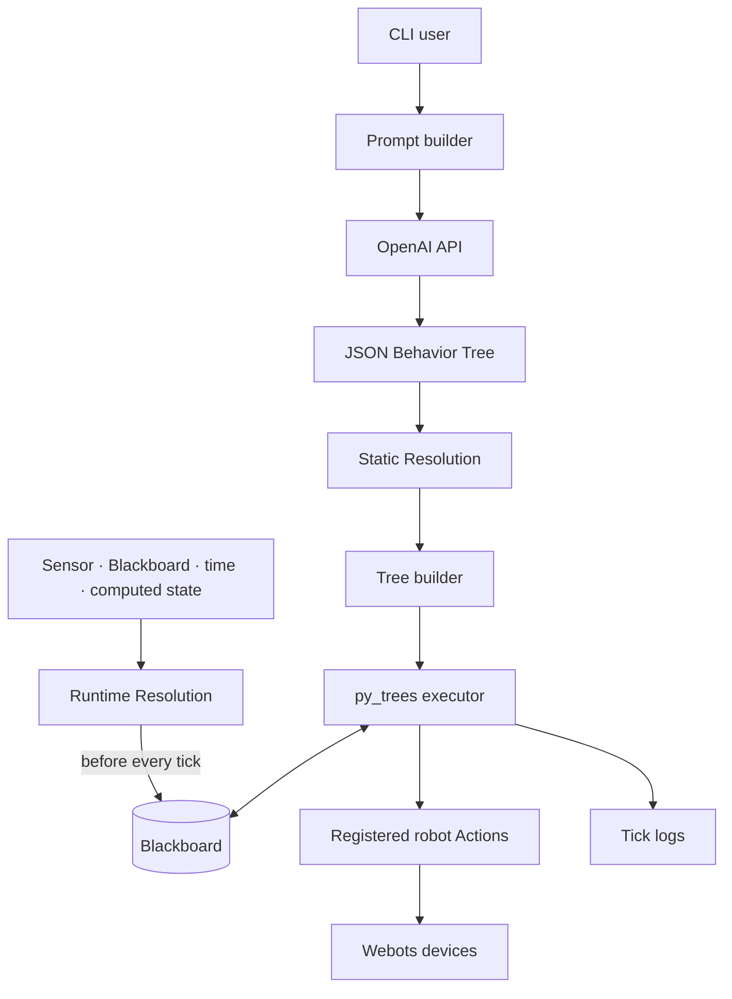

# Architecture

BehaviorOS v0.1 separates natural-language planning, value resolution, behavior-tree
execution, and robot-specific code.

## System view



## Components

### Prompt and LLM layer

`build_prompt()` combines the user request with registered Action metadata and
few-shot examples. `OpenAIClient` requests a JSON object and returns its text content.
The robot client parses it and sends it to the Webots controller.

### Value Resolution

Static Resolution computes a value once while the tree is built. Runtime Resolution
finds runtime placeholders, reruns their resolvers before every tick, and updates the
Blackboard. The distinction is recomputation timing, not the source of the value.

### Tree execution

`TreeExecutor` converts JSON composites into `py_trees` Sequence, Selector, and
Parallel nodes. A leaf `type` is looked up in the Action registry and instantiated
with a shared Blackboard.

### Robot layer

Each Webots controller imports robot-specific Action and resolver modules. The
decorators in those modules populate global registries at import time.

## Repository structure

```text
behavioros/
├── behavioros/
│   ├── core/          # TreeExecutor, TreeBuilder, Action registry
│   ├── resolution/    # Static and Runtime processors
│   ├── prompts/       # Prompt and few-shot example registry
│   ├── llm/           # OpenAI client abstraction
│   ├── hooks/         # Runtime and logging hooks
│   └── logging/       # Tick tracking and file output
├── controllers/
│   ├── youbot_controller/
│   ├── turtlebot_controller/
│   └── tiago_controller/
└── worlds/            # Webots demo worlds
```

## Current execution boundary

The current executor is Python `py_trees`; BehaviorTree.CPP and ROS 2 are not part of
v0.1.

## Known limitations

- The generated JSON is not validated against an enforced schema.
- Unknown Action handling is not fail-closed in the current executor.
- Action fields are copied into a shared Blackboard, so repeated keys can collide.
- Hook exceptions are logged but do not automatically stop execution.
- The global registries depend on import order.
