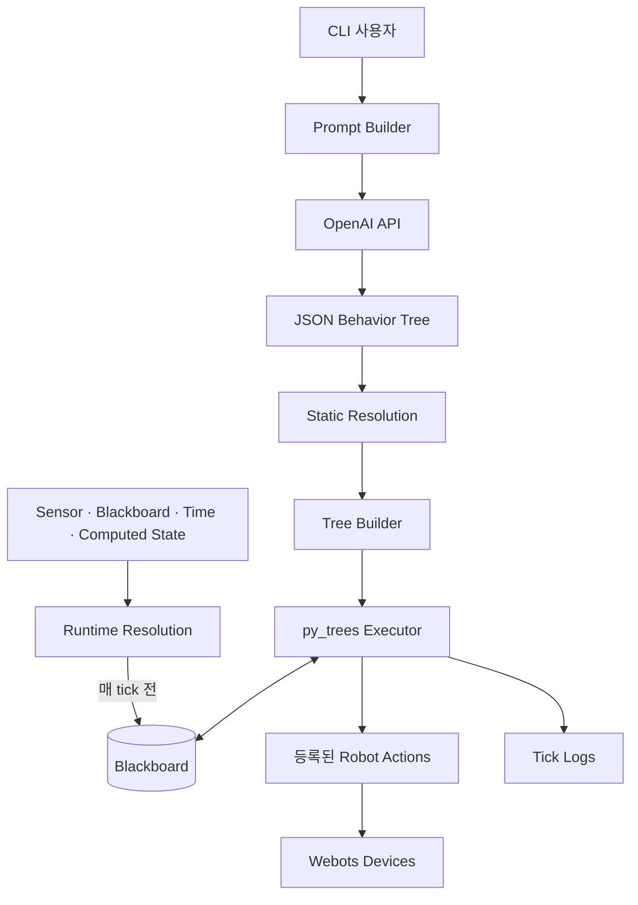

# 아키텍처

BehaviorOS v0.1은 자연어 계획, Value Resolution, Behavior Tree 실행, 로봇별 코드를
분리합니다.

## 전체 구조



## 컴포넌트

### Prompt와 LLM

`build_prompt()`는 사용자 요청에 등록된 Action 메타데이터와 few-shot 예제를
결합합니다. `OpenAIClient`는 JSON object 형식의 응답을 요청하고 텍스트를
반환합니다. 로봇 client가 이를 파싱해 Webots controller로 보냅니다.

### Value Resolution

Static Resolution은 트리를 만드는 동안 값을 한 번 계산합니다. Runtime
Resolution은 runtime placeholder를 찾아 매 tick 전에 resolver를 다시 실행하고
Blackboard 값을 갱신합니다. 두 방식의 차이는 값의 출처가 아니라 재계산 시점입니다.

### Tree 실행

`TreeExecutor`는 JSON composite를 `py_trees`의 Sequence, Selector, Parallel node로
변환합니다. leaf의 `type`은 Action registry에서 조회하고 공유 Blackboard와 함께
생성합니다.

### Robot layer

각 Webots controller는 로봇별 Action과 resolver 모듈을 import합니다. 이 모듈의
데코레이터가 import 시점에 global registry를 채웁니다.

## 저장소 구조

```text
behavioros/
├── behavioros/
│   ├── core/          # TreeExecutor, TreeBuilder, Action registry
│   ├── resolution/    # Static/Runtime processor
│   ├── prompts/       # Prompt와 few-shot example registry
│   ├── llm/           # OpenAI client abstraction
│   ├── hooks/         # Runtime과 logging hook
│   └── logging/       # Tick tracking과 file output
├── controllers/
│   ├── youbot_controller/
│   ├── turtlebot_controller/
│   └── tiago_controller/
└── worlds/            # Webots demo world
```

## 현재 실행 경계

현재 executor는 Python `py_trees`입니다. BehaviorTree.CPP와 ROS 2는 v0.1의 일부가
아닙니다.

## 알려진 한계

- 생성된 JSON을 강제 schema로 검증하지 않습니다.
- 현재 executor의 알 수 없는 Action 처리는 fail-closed 방식이 아닙니다.
- Action field를 공유 Blackboard에 복사하므로 반복 key가 충돌할 수 있습니다.
- Hook 예외는 출력되지만 자동으로 실행을 중단하지 않습니다.
- Global registry가 import 순서에 의존합니다.
