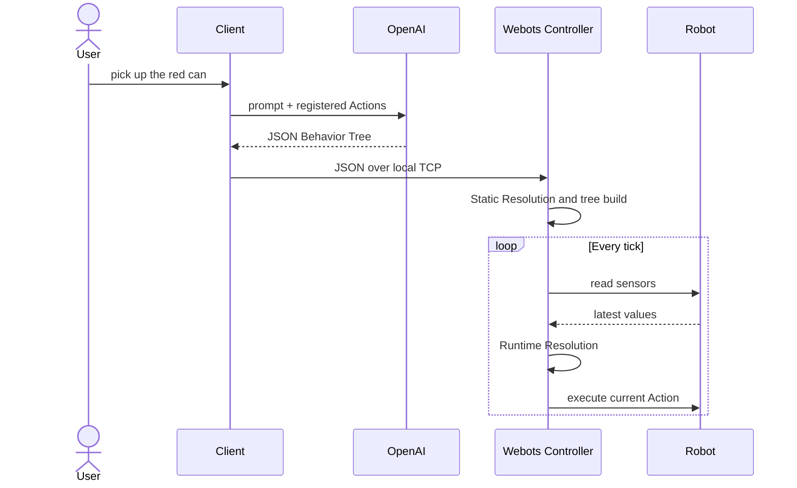

# Getting Started

This guide runs the BehaviorOS v0.1 prototype with Webots and the KUKA YouBot demo.

## Requirements

- Python 3.10+
- Webots R2023b+
- An OpenAI API key

## Install

```bash
git clone <repository-url>
cd BehaviorOS

python -m venv venv
source venv/bin/activate
pip install -e ".[llm]"
```

Set the API key without committing it to the repository:

```bash
export OPENAI_API_KEY="your-api-key"
```

## Run the YouBot demo

1. Open `worlds/youbot_can_demo.wbt` in Webots.
2. Start the simulation and confirm that the controller is listening on port `9999`.
3. From the repository root, start the client:

```bash
python controllers/youbot_controller/youbot_client.py
```

Then enter a supported command:

```text
> pick up the red can
```

The client builds a robot-specific prompt, calls OpenAI, parses the returned JSON,
and sends the tree to the Webots controller over a local TCP connection.

## What happens next



## Troubleshooting

### Connection refused

Make sure the Webots simulation is running and the robot controller has opened port
`9999` before starting the client.

### Missing API key

Confirm that `OPENAI_API_KEY` is available in the shell running the client.

### Unknown Action

The Action module must be imported before a tree is built because decorators register
Actions at import time. An unknown Action currently indicates an invalid generated
plan; v0.1 does not yet provide a strict pre-execution validator.

!!! warning "Prototype only"
    This demo is not a deployment guide for a physical robot. v0.1 has no enforced
    plan schema, parameter constraints, or safety policy.
