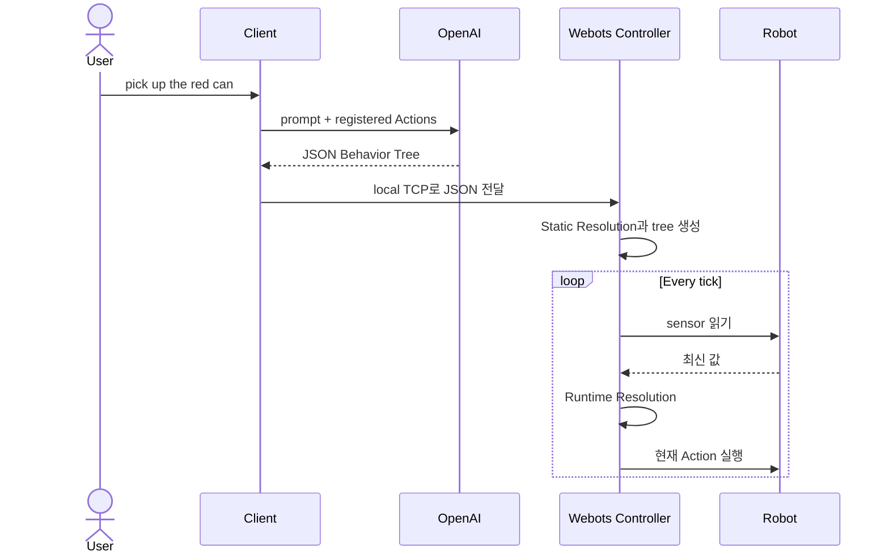

# 시작하기

Webots와 KUKA YouBot 데모로 BehaviorOS v0.1 프로토타입을 실행합니다.

## 요구사항

- Python 3.10+
- Webots R2023b+
- OpenAI API key

## 설치

코드 접근 권한이 있는 환경에서 프로젝트 소스를 준비합니다.

```bash
cd BehaviorOS

python -m venv venv
source venv/bin/activate
pip install -e ".[llm]"
```

API key를 저장소에 commit하지 않고 설정합니다.

```bash
export OPENAI_API_KEY="your-api-key"
```

## YouBot 데모 실행

1. Webots에서 `worlds/youbot_can_demo.wbt`를 엽니다.
2. 시뮬레이션을 시작하고 controller가 `9999` port에서 대기하는지 확인합니다.
3. 저장소 root에서 client를 실행합니다.

```bash
python controllers/youbot_controller/youbot_client.py
```

지원되는 명령을 입력합니다.

```text
> pick up the red can
```

Client는 로봇별 prompt를 만들고 OpenAI를 호출한 뒤, 반환된 JSON을 파싱해 local
TCP 연결로 Webots controller에 전달합니다.

## 내부 실행 흐름



## 문제 해결

### Connection refused

Client를 실행하기 전에 Webots 시뮬레이션과 robot controller가 실행 중이고
`9999` port를 열었는지 확인합니다.

### API key 없음

Client를 실행하는 shell에 `OPENAI_API_KEY`가 설정되어 있는지 확인합니다.

### 알 수 없는 Action

데코레이터는 import 시 Action을 등록하므로 tree를 만들기 전에 해당 Action 모듈을
import해야 합니다. 알 수 없는 Action은 잘못 생성된 계획을 의미하지만, v0.1은
아직 엄격한 실행 전 validator를 제공하지 않습니다.

!!! warning "프로토타입 전용"
    이 문서는 실제 로봇 배포 가이드가 아닙니다. v0.1에는 강제 plan schema,
    parameter constraint, safety policy가 없습니다.
