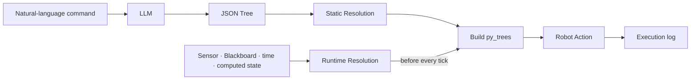

# BehaviorOS

> **A behavior-tree prototype that resolves LLM plan values at the time they need to be computed**

The user describes a goal in natural language. An LLM produces a JSON Behavior Tree,
and BehaviorOS converts it into an executable `py_trees` object. Named values in the
plan are either computed once while the tree is built or recomputed before every tick.

!!! info "In one sentence"
    **The LLM creates the plan; resolvers compute concrete values when they are needed.**

<video width="100%" controls preload="metadata">
  <source src="assets/demo.mp4" type="video/mp4">
  Your browser does not support video playback.
</video>

<p><small>A v0.1 demo of a YouBot executing an LLM-generated Behavior Tree in Webots.</small></p>

---

## The problem

LLMs are useful for turning goals such as “pick up the red can” into multi-step plans.
Their text output, however, cannot be sent directly to robot motors.

BehaviorOS v0.1 sits between planning and robot control:

1. It asks the LLM for a constrained JSON Behavior Tree.
2. It converts JSON nodes into registered robot Actions and `py_trees` nodes.
3. It connects names in the plan to values computed by registered resolvers.

---

## Core idea: fill in values at execution time

The LLM does not guess an object's coordinates. It leaves a named placeholder in the
plan:

```json
{
  "type": "pick_can",
  "name": "Pick the nearest red can",
  "nearest_can": "${nearest_red_can}"
}
```

For example, before each tree tick, a camera resolver can write the latest value for
`${nearest_red_can}` to the Blackboard:

```json
{
  "detected": true,
  "x": 0.35,
  "y": 0.05,
  "z": 0.12
}
```

BehaviorOS calls the overall mapping from a name in the plan to a concrete value
**Value Resolution**. A value computed once while building the tree uses Static
Resolution; a value recomputed before every tick uses Runtime Resolution. The
distinction is about **when to compute the value**, not where it comes from.

---

## Execution flow



---

## What was designed and implemented

- Prompt generation from registered Actions and few-shot examples
- Conversion of OpenAI JSON responses into `sequence`, `selector/fallback`, and
  `parallel` trees
- Static Resolution for values computed once during tree construction
- Runtime Resolution for values that must be recomputed before every tick
- Blackboard-based Action I/O and tick-level execution logs
- Webots controllers for KUKA YouBot, TurtleBot3, and TIAGo

---

## Current status

BehaviorOS v0.1 is a Python prototype used to test the idea in Webots.

The next version will not simply extend this prototype. It will redesign the contract
between plan generation and execution. The proposed architecture and its technical
choices are explained in [Next Version](next-version.en.md).

!!! warning "Current limitation"
    v0.1 is a research and design prototype. It does not yet provide the schema
    validation, parameter constraints, cancellation, or safety policy required for
    deployment on a physical robot.

---

## Explore

| Page | What it covers |
| --- | --- |
| [What This Library Solves](what-this-library-solves.md) | Scope and design motivation |
| [Architecture](architecture.md) | Data flow from command to execution |
| [Value Resolution](resolution.md) | Connecting one-time and repeatedly computed values |
| [Getting Started](getting-started.md) | Running the v0.1 Webots prototype |
| [Next Version](next-version.md) | Planned Plan IR, BehaviorTree.CPP, and ROS 2 redesign |
