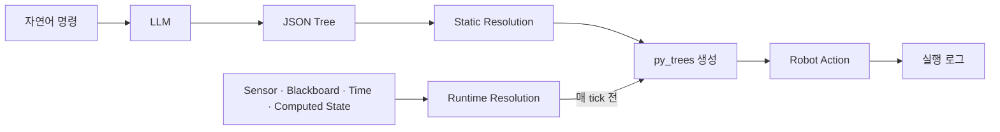

# BehaviorOS

> **LLM이 만든 행동 계획의 값을 필요한 계산 시점에 연결해 실행하는 Behavior Tree 프로토타입**

사용자는 자연어로 목표를 말합니다. LLM은 JSON Behavior Tree를 만들고,
BehaviorOS는 그 트리를 `py_trees` 실행 객체로 변환합니다. 계획에 남겨 둔 이름은
트리를 만들 때 한 번 계산하거나 실행 중 매 tick 다시 계산해 실제 값으로 바꿉니다.

!!! info "한 문장으로"
    **계획은 LLM이 만들고, 구체적인 값은 resolver가 필요한 시점에 계산합니다.**

<video width="100%" controls preload="metadata">
  <source src="assets/demo.mp4" type="video/mp4">
  브라우저가 동영상 재생을 지원하지 않습니다.
</video>

<p><small>Webots에서 자연어 명령으로 생성한 Behavior Tree를 YouBot이 실행하는 v0.1 데모입니다.</small></p>

---

## 해결하려는 문제

LLM은 “빨간 캔을 집어” 같은 목표를 여러 단계의 계획으로 바꾸는 데 유용합니다.
하지만 LLM이 만든 텍스트를 모터 명령으로 바로 실행할 수는 없습니다.

BehaviorOS v0.1은 그 사이에서 세 가지 역할을 합니다.

1. LLM 응답을 제한된 JSON Behavior Tree 형식으로 받습니다.
2. JSON 노드를 등록된 로봇 Action과 `py_trees` 노드로 변환합니다.
3. 계획 속 이름을 필요한 시점에 resolver가 계산한 값과 연결합니다.

---

## 핵심 아이디어: 실행 직전에 값 채우기

LLM이 물체의 실제 좌표를 추측하게 하지 않습니다. 계획에는 값이 들어갈 자리를
이름으로 남겨 둡니다.

```json
{
  "type": "pick_can",
  "name": "Pick the nearest red can",
  "nearest_can": "${nearest_red_can}"
}
```

예를 들어 트리를 실행하기 전마다 카메라 resolver가 `${nearest_red_can}`의 최신
값을 Blackboard에 기록할 수 있습니다.

```json
{
  "detected": true,
  "x": 0.35,
  "y": 0.05,
  "z": 0.12
}
```

BehaviorOS는 계획 속 이름을 실제 값에 대응시키는 전체 과정을
**Value Resolution**이라고 부릅니다. 트리를 만들 때 한 번 계산하면
Static Resolution, 매 tick 전에 다시 계산하면 Runtime Resolution입니다. 값의
출처가 아니라 **언제 다시 계산해야 하는지**에 따른 구분입니다.

---

## 실행 흐름



---

## 설계·구현 범위

- 등록된 Action과 few-shot 예제를 이용한 LLM 프롬프트 생성
- OpenAI JSON 응답을 `sequence`, `selector/fallback`, `parallel` 트리로 변환
- 트리 생성 시 값을 한 번 계산하는 Static Resolution
- 매 tick 다시 계산해야 하는 값을 갱신하는 Runtime Resolution
- Blackboard 기반 Action 입출력과 실행 로그
- Webots의 KUKA YouBot, TurtleBot3, TIAGo 예제 컨트롤러

---

## 현재 상태

BehaviorOS v0.1은 아이디어를 Webots에서 검증한 Python 프로토타입입니다.

!!! warning "현재 버전의 한계"
    v0.1은 연구·설계 검증용입니다. 생성된 계획을 실제 로봇에서 안전하게 실행하기
    위한 schema validation, parameter constraints, cancellation과 safety policy는 아직
    제공하지 않습니다.

---

## 더 알아보기

| 문서 | 내용 |
| --- | --- |
| [해결하려는 문제](what-this-library-solves.md) | 이 프로토타입의 범위와 선택 이유 |
| [아키텍처](architecture.md) | 자연어 입력부터 실행까지의 데이터 흐름 |
| [Value Resolution](resolution.md) | 값을 한 번 계산할지 반복해서 계산할지 구분하는 방식 |
| [시작하기](getting-started.md) | Webots 기반 v0.1 실행 방법 |
