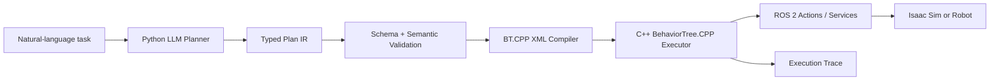

# Next Version

> This page describes a **plan**. The architecture below is not implemented in the
> current v0.1 prototype.

The next version of BehaviorOS will not extend the Webots + Python `py_trees`
prototype in place. It will define a typed Plan IR contract between planning and
execution, with a Python planner and a C++ executor separated by a ROS 2 boundary.

## Target architecture



## Why redesign it?

In v0.1, LLM JSON, Action parameters, and Blackboard keys are loosely connected. That
was useful for testing the idea quickly, but it makes several requirements difficult
to enforce:

- no mandatory schema for validating a generated plan before execution;
- no typed contract between shared Blackboard keys and Action inputs;
- no explicit boundary between the Python planner and robot execution lifecycle;
- no consistent execution layer for timeout, cancellation, and halt;
- no unified trace from prompt generation to ROS capability results.

## Main changes

| v0.1 prototype | Planned next version |
| --- | --- |
| LLM directly generates a JSON Tree | LLM generates a constrained typed Plan IR |
| Python `py_trees` execution | C++ BehaviorTree.CPP execution |
| String placeholders and a shared dict | Typed inputs/outputs and explicit references |
| Prompt-guided Action selection | Capability catalog plus schema/semantic validation |
| Direct Webots device calls | ROS 2 Action/Service capabilities |
| Tick files | Connected events from planner to Action result |

## Python and C++ responsibilities

### Python planner

- CLI and a future Python SDK
- LLM provider calls and prompt management
- Capability catalog construction
- Plan IR parsing and validation
- Deterministic Plan IR-to-BT XML compilation

### C++ executor

- BehaviorTree.CPP factory and executor lifecycle
- BT node plugins, ports, and Blackboard
- ROS 2 Action/Service clients
- Timeout, halt, and cancellation
- Node transition events

## First vertical slice

The first end-to-end target is:

```text
Find the nearest red cube and place it in the storage bin.
```

The demo is intended to show natural-language input, capability discovery, Plan IR,
validation, BT XML, ROS 2 capability calls, simulator behavior, and a connected trace.

## Deferred from the initial scope

- Runtime dynamic replanning
- Plan critique and automatic repair
- Dynamic Behavior Tree expansion
- A real perception model and physical robot integration
- Complete support for multiple LLM providers
- Multi-robot collaboration and an approval policy engine

The current v0.1 site remains a record of the prototype and its design lessons. Planned
features will not be presented as current capabilities before they are implemented.
