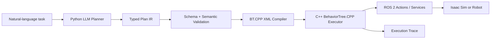

# 다음 버전

> 이 페이지는 **계획**을 설명합니다. 아래 구조는 현재 v0.1에 구현되어 있지
> 않습니다.

BehaviorOS의 다음 버전은 Webots + Python `py_trees` 프로토타입을 그대로 확장하지
않습니다. 계획 생성과 실행 사이의 계약을 typed Plan IR로 정의하고, Python planner와
C++ executor를 ROS 2 경계로 분리하는 방향으로 다시 설계합니다.

## 목표 구조



## 왜 다시 설계하는가

v0.1에서는 LLM JSON, Action parameter, Blackboard key가 느슨하게 연결됩니다. 빠르게
아이디어를 시험하기에는 좋았지만 다음 문제를 구조적으로 해결하기 어렵습니다.

- 생성된 plan을 실행 전에 강제로 검증할 schema가 없음
- 공유 Blackboard key와 Action 입력 사이에 typed contract가 없음
- Python planner와 robot execution lifecycle이 명확히 분리되지 않음
- timeout, cancellation, halt를 일관되게 처리할 실행 경계가 없음
- 실행 trace가 prompt부터 ROS capability 결과까지 하나로 연결되지 않음

## 핵심 변경

| v0.1 프로토타입 | 다음 버전 계획 |
| --- | --- |
| LLM이 JSON Tree 직접 생성 | LLM이 제한된 typed Plan IR 생성 |
| Python `py_trees` 실행 | C++ BehaviorTree.CPP 실행 |
| 문자열 placeholder와 공유 dict | typed input/output와 명시적 reference |
| Prompt 중심의 Action 제한 | capability catalog + schema/semantic validation |
| Webots device 직접 호출 | ROS 2 Action/Service capability 호출 |
| tick file log | planner부터 Action 결과까지 연결된 event trace |

## Python과 C++의 책임

### Python planner

- CLI와 향후 Python SDK
- LLM provider 호출과 prompt 관리
- Capability catalog 구성
- Plan IR parsing과 validation
- Plan IR에서 BT XML로의 결정적 compile

### C++ executor

- BehaviorTree.CPP factory와 executor lifecycle
- BT node plugin과 port/blackboard 관리
- ROS 2 Action/Service client
- timeout, halt, cancellation
- node transition event 생성

## 첫 vertical slice

첫 목표는 다음 명령을 end-to-end로 시연하는 것입니다.

```text
가장 가까운 빨간 큐브를 찾아 보관함에 넣어.
```

데모는 자연어 입력, capability 확인, Plan IR, validation, BT XML, ROS 2 capability
호출, simulator 동작, 전체 trace를 한 흐름으로 보여주는 것을 목표로 합니다.

## 초기 범위에서 제외

다음 기능은 첫 재설계 범위 이후로 둡니다.

- 실행 중 dynamic replanning
- plan critique와 automatic repair
- dynamic Behavior Tree expansion
- 실제 perception model과 실제 로봇 통합
- 여러 LLM provider의 완전한 지원
- multi-robot collaboration과 approval policy engine

현재 사이트의 v0.1 문서는 과거 프로토타입의 설계와 학습 내용을 기록합니다. 다음
버전 기능이 구현되기 전에는 이를 현재 기능으로 표시하지 않습니다.
